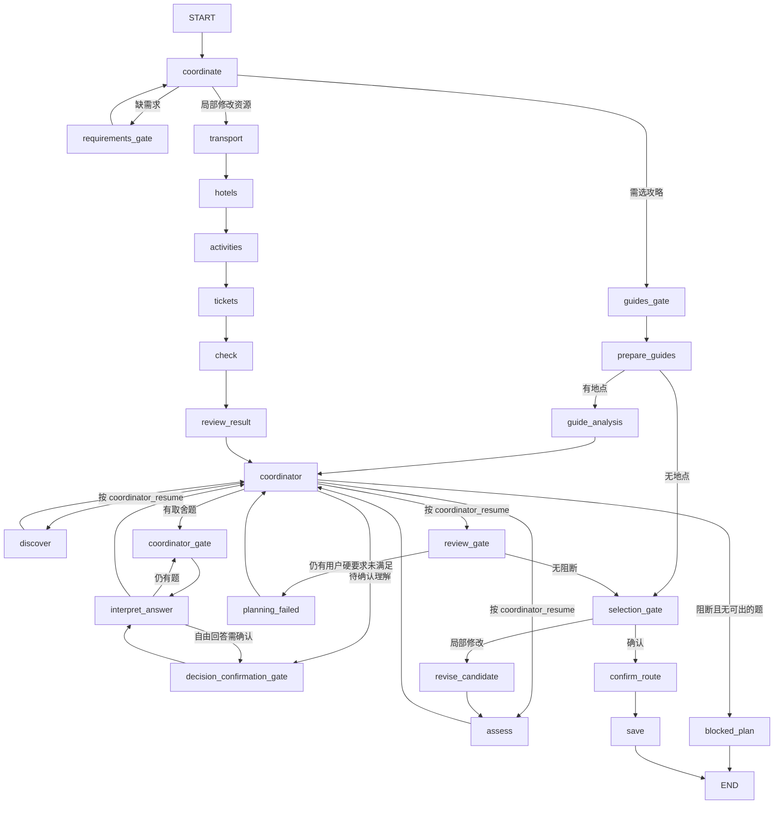

# 架构

本文描述系统**现在是怎样运行的**。为什么这样设计、有哪些取舍，见 [DESIGN_DECISIONS.md](DESIGN_DECISIONS.md)。

## 进程与组件

```text
浏览器 (Vue 3)
   │  REST + SSE（同源，127.0.0.1:8000）
   ▼
FastAPI (backend/app/main.py)
   ├─ Store            trips.sqlite：旅行文档、版本、运行、事件、查询记录、Agent 结果缓存
   ├─ Planner          LangGraph 图 + checkpoints.sqlite
   │    ├─ GuideAgent / RouteAgent / ResourceAgent / ReviewerAgent / CoordinatorAgent  （共享 AgentRuntime）
   │    ├─ 代码排程     opening.py · day_clustering.py · scheduler.py · tradeoffs.py
   │    └─ 规则模块     rules.py · decisions.py · reviewing.py · dining.py · places.py · routing.py
   └─ Adapters (adapters.py)
        ├─ Models  ──► Node 子进程 model-runtime/bridge.mjs（pi-ai）
        ├─ Amap    ──► 高德 MCP（Streamable HTTP）
        ├─ FlyAI   ──► 飞猪 CLI 子进程
        └─ Crawler ──► MediaCrawler 子进程（独立 Python 3.11 环境）
```

规划任务作为 `asyncio.Task` 在服务进程内运行（`Planner.execute`），进度写入 `events` 表，前端通过 SSE（`GET /api/runs/{id}/events`，支持 `Last-Event-ID` 续传）读取。关闭网页不影响任务。

## 代码组织

`Planner` 由若干按职责划分的 mixin 组合而成，方法名与调用方式不变（`self.xxx`），只是实现分散在不同文件：

| 文件 | 内容 |
|---|---|
| [planner.py](../backend/app/planner.py) | `Planner.__init__`、图定义 `graph`、`execute()`，以及所有调用 `interrupt()` 的 gate 节点（`requirements_gate` / `guides_gate` / `coordinator_gate` / `decision_confirmation_gate` / `selection_gate`）、`confirm_route`、`save` |
| [workflow/state.py](../backend/app/workflow/state.py) | `TripState` 与节点到前端阶段的映射 `NODE_STAGES` |
| [workflow/submit.py](../backend/app/workflow/submit.py) | 用户入口：`submit` / `back_to_step` / `reopen_decision`（撤回某次回答并重新出题）/ `delete_trip` 及其版本校验 |
| [nodes/guides.py](../backend/app/nodes/guides.py) | `coordinate`、攻略解析 `prepare_guides`、`guide_analysis`、Agent 工具分发 `agent_tool` |
| [nodes/candidates.py](../backend/app/nodes/candidates.py) | `discover`（行程 Agent 选点 + 代码重新分天）/ `assess` / `revise_candidate` 与受影响范围计算 |
| [opening.py](../backend/app/opening.py) | 把高德营业时间解析成按日期的 `open/closed/unknown`、时段和停止入场时刻 |
| [day_clustering.py](../backend/app/day_clustering.py) | 代码按位置分天：`build_spatial_plan`（各城天数、每日容量、固定日期）、`recluster_candidate`（对行程 Agent 选中的景点重新分天） |
| [scheduler.py](../backend/app/scheduler.py) | 纯代码排程：`plan_day`（当天顺序与时刻）、`plan_trip`（移日、补位）、`long_leg_candidates`（长路段调换） |
| [nodes/scheduling.py](../backend/app/nodes/scheduling.py) | `activities` / `code_schedule`（按选定顺序查高德真实交通、去点后重排、长路段修正）/ `movement`（步行与公交选择）/ `window` / `refresh_day_routes` |
| [nodes/resources.py](../backend/app/nodes/resources.py) | `transport` / `hotels` / `tickets`、`query_ticket_prices`（飞猪门票，并发与重试）、`refresh_expired_resources` |
| [nodes/locations.py](../backend/app/nodes/locations.py) | `locate_stops`（高德定位与同名地点澄清）、天气上下文 |
| [nodes/review_loop.py](../backend/app/nodes/review_loop.py) | `check` / `audit` / `assess_result` / `repair_review_duplicates`（核实重复后删一补一）/ `review_gate` / `review_result` / `planning_failed` |
| [nodes/coordinating.py](../backend/app/nodes/coordinating.py) · [coordinator.py](../backend/app/coordinator.py) · [tradeoffs.py](../backend/app/tradeoffs.py) | 主理人：收集用户硬要求未满足项、由代码模拟生成取舍题、执行回答、记录可撤回的回答快照 |

把全部 `interrupt()` 留在 `planner.py`，是为了在一个文件里就能看清「流程会在哪里停下来等用户」。

## LangGraph 图

图在 [planner.py](../backend/app/planner.py) `Planner.graph` 中定义。下面是实际的边（省略了少数仅用于兼容旧检查点的分支）：



带 `_gate` 后缀的节点会调用 `interrupt()` 暂停，等待用户输入：

| 节点 | interrupt kind | 等待什么 |
|---|---|---|
| `requirements_gate` | `requirements` | 补全日期、人数等必填项 |
| `guides_gate` | `guides` | 勾选参考攻略 |
| `coordinator_gate` | `decision` | 回答一批代码生成的取舍题（点选项，或写自由回答） |
| `decision_confirmation_gate` | `decision_confirmation` | 确认主理人对自由回答的理解 |
| `selection_gate` | `selection` / `sources` | 确认候选，或提交局部修改 |

### 主要节点做什么

- **coordinate**：读取需求和用户消息；修改请求由模型解析为 `ChangeRequest`（影响哪些城市、日期、资源）。不是 Agent，只是一次结构化抽取。
- **prepare_guides**：解析所选攻略的正文和图片，产出带证据的地点池 `stops`。
- **guide_analysis**：GuideAgent 整理区域分组、必去/排除和时长线索。
- **discover**：RouteAgent 调用一次，只选整趟要去的景点、估计缺失的游玩时长、给出优先级；分天前先给选中但还没坐标的景点查高德坐标，再由代码 `recluster_candidate` 按位置、每日容量、固定日期和闭馆信息重新分天。消融开关 `no_clustering` 恢复由 RouteAgent 自行分日。
- **assess**：对初案依次执行 `transport → hotels → activities → tickets → check`，然后由检验 Agent 做语义审查（见下）。
- **activities**：代码排程。`plan_trip` 按估计交通（直线距离换算）为每天求可行的最短顺序，放不下的普通景点按优先级移到最近的一天或省略；`code_schedule` 只对选定顺序的相邻路段查高德，按真实耗时重算时刻，去点后重新排序，并在相邻路段过长时尝试与其他日期调换景点（只在最长路段变短且总交通不增加时采用）。步行不超过 25 分钟且不比公交慢 5 分钟以上时选步行。到达/出发的车站、机场会先固定到一个高德 POI，无法唯一确定时出一道「选择航站楼/进出站口」的题，回答记入 `decision_history` 并复用。
- **tickets**：除餐饮外的游览景点都查飞猪门票；收费景点按参考价和人数计入预算，飞猪标为收费但没有在售价格时再用关键词搜索门票商品查价。
- **coordinator**：收集用户硬要求未满足的项（必去/想去没排进、包含排除地点、预约时刻冲突、已选班次冲突、超预算、没有逐日草稿），交给 `tradeoffs.py` 模拟每个选项的真实结果后出题；CoordinatorAgent 只写标题、说明和推荐理由。没有可出的题时进入 `blocked_plan`。
- **interpret_answer**：执行回答对应的动作并局部重排；自由回答由 CoordinatorAgent 理解后先请用户确认。每次回答都另存答题前的方案快照（`decision_snapshots`，不进入模型输入，也不返回前端），供 `reopen_decision` 撤回重答。
- **transport**：按城市顺序生成城际段。需求勾选 `self_arranged_round_trip`（往返交通自行安排）时，不生成出发地往返两段，只保留目的地之间的交通。
- **confirm_route → save**：重新检查用户硬要求，并确认待确认路线内容没有变化，把同一份快照原子写入。

### 检查与语义审查

在 `assess_result()` 中，每份候选都会走：

```text
check（代码规则：只判用户硬要求为阻断，其余为提示）
   → audit（ReviewerAgent 语义审查，只产生提示与疑似重复）
   → repair_review_duplicates（疑似重复经代码核对后，删一个、当天补一个附近景点；每次生成最多一轮）
```

时间、营业、交通、预算由代码负责，检验 Agent 不再判断这些，也不产生阻断；不再有审查-修复循环，因为排程按构造已经可行。

## 五个 Agent

都继承 [AgentRuntime](../backend/app/agents/runtime.py)，差别在指令、输入、输出 schema 和工具。输入由 [views.py](../backend/app/views.py) 按字段白名单裁剪，并有字数上限：

| Agent | 文件 | 输出 schema | 可用工具 | 不允许 |
|---|---|---|---|---|
| 攻略 | `agents/guide.py` | `GuideBrief` | 无（读攻略原文/图片） | 引用池外地点 |
| 行程 | `agents/route.py` | `RouteTurn` | 高德 place / route / weather，`guide_feedback` | 引用池外地点；删必去/锁定项；决定每日顺序与时刻 |
| 资源 | `agents/resource.py` | `ResourceChoice` | 飞猪交通/住宿/门票 | 查询旅行城市以外；为未排进行程的地点查门票；安排游览 |
| 检验 | `agents/reviewer.py` | `SemanticReviewReport` | 无（只读已保存的证据） | 修改计划；判时间/交通/预算；产生阻断 |
| 主理人 | `agents/coordinator.py` | 题目措辞、对自由回答的理解 | 无 | 自己提出方案；改动代码生成的选项结果 |

`AgentRuntime.ask()` 的执行过程：

1. `assert_current`：确认这个运行还是该旅行的当前运行。
2. 按（角色、模型、schema、指令、输入、generation）计算缓存键，命中 `agent_results` 就直接返回。
3. 最多 4 轮模型调用、3 轮工具：模型返回 `status=tools` 时执行工具，结果作为 `tool_observations` 回传；第 4 轮强制使用不含工具字段的收尾 schema。
4. 同一轮里语义相同的工具请求去重；一轮里全是重复请求时直接进入收尾，不浪费轮次。
5. 每次模型和工具调用后再次 `assert_current`，旧运行的结果不会写回。
6. 每个工具结果都写入 `queries` 表并得到 `evidence_id`，后续行程和审查只能引用这些 ID。

RouteAgent 和 GuideBrief 额外把超过 24 个字符的内部 ID 替换为 `stop_1` 这样的短编号再发给模型，返回后映射回来（模型抄写长 ID 容易出错）。

## 检验报告与确认门禁

- [reviewing.py](../backend/app/reviewing.py) 的 `bind_report` 在报告上记录 `review_id`、`policy_version`、`draft_revision` 和依据哈希，`review_scope` 把可计算的事实（逐活动开放窗口、景点间衔接）预先算好交给检验 Agent。
- 检验 Agent 的发现只能引用当前行程里真实存在的路径、日期和证据 ID，不符合的直接丢弃，严重性一律降为提示；疑似重复只保留两项都在当前行程中的组合。
- 确认门禁在 [decisions.py](../backend/app/decisions.py) 的 `confirmation_issues`：只有用户硬要求未满足才阻断。展示、确认、保存时都会重新计算；`confirm_route` 还会核对路线内容哈希和需求、攻略选择、当前运行是否已变化。

## 存储与并发

`trips.sqlite` 主要表：

| 表 | 内容 |
|---|---|
| `trips` | 当前文档（JSON）、`version`、`active_run`、`active_thread`、`updated_at` |
| `versions` | 用户手动保存的历史快照，版本号不复用 |
| `runs` / `events` | 每次规划运行的状态和进度事件 |
| `queries` | 每次外部查询的请求和脱敏结果，即 `evidence_id` 的来源 |
| `agent_results` | Agent 输出和工具观察的缓存 |

并发控制：

- 每个旅行一把 `asyncio.Lock`（`Planner.gate`），同一时刻只处理一个提交。
- 写操作带 `base_version` / `updated_at`，在 `BEGIN IMMEDIATE` 事务内比对，不一致返回 409。
- `start_run` 在同一事务中检查是否已有 `running` 的运行。
- 服务启动时把遗留的 `running` 运行改为 `recoverable`。

每次「重新规划」使用新的 LangGraph thread（`{trip_id}:{uuid}`）；中断回答、局部修改、继续任务复用当前 thread。返回上一步或删除旅行时删除对应检查点。

## 前端

`frontend/src/App.vue` 管理当前旅行和运行状态；`workflow.ts` 根据文档的 `workflow_step` 和 `pending.kind` 决定显示哪个步骤（需求 → 攻略 → 追问 → 路线 → 行程）。所有写请求都携带 `base_version`，收到 409 时提示刷新。
