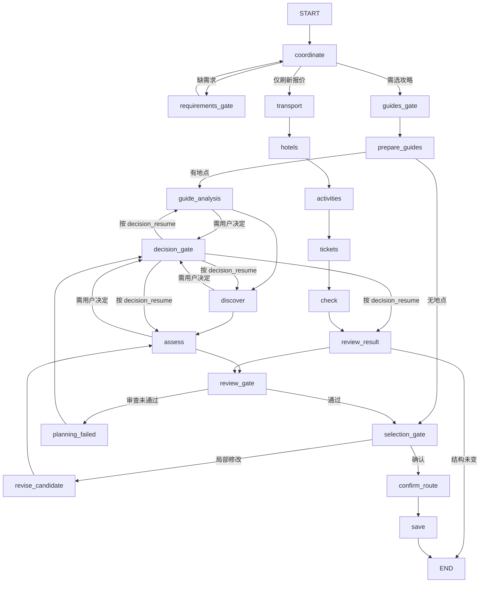

# 架构

本文描述系统**现在是怎样运行的**。为什么这样设计、有哪些取舍，见 [DESIGN_DECISIONS.md](DESIGN_DECISIONS.md)。

## 进程与组件

```text
浏览器 (Vue 3)
   │  REST + SSE（同源，127.0.0.1:8000）
   ▼
FastAPI (backend/app/main.py)
   ├─ Store            trips.sqlite：旅行文档、版本、运行、事件、查询记录、Agent 结果缓存
   ├─ Planner          LangGraph 图 + checkpoints.sqlite
   │    ├─ GuideAgent / ResourceAgent / RouteAgent / ReviewerAgent  （共享 AgentRuntime）
   │    └─ 规则模块     rules.py · reviewing.py · decisions.py · dining.py · places.py · routing.py
   └─ Adapters (adapters.py)
        ├─ Models  ──► Node 子进程 model-runtime/bridge.mjs（pi-ai）
        ├─ Amap    ──► 高德 MCP（Streamable HTTP）
        ├─ FlyAI   ──► 飞猪 CLI 子进程
        └─ Crawler ──► MediaCrawler 子进程（独立 Python 3.11 环境）
```

规划任务作为 `asyncio.Task` 在服务进程内运行（`Planner.execute`），进度写入 `events` 表，前端通过 SSE（`GET /api/runs/{id}/events`，支持 `Last-Event-ID` 续传）读取。关闭网页不影响任务。

## LangGraph 图

图在 [planner.py](../backend/app/planner.py) `Planner.graph` 中定义。下面是实际的边（省略了少数仅用于兼容旧检查点的分支）：



带 `_gate` 后缀的节点会调用 `interrupt()` 暂停，等待用户输入：

| 节点 | interrupt kind | 等待什么 |
|---|---|---|
| `requirements_gate` | `requirements` | 补全日期、人数等必填项 |
| `guides_gate` | `guides` | 勾选参考攻略 |
| `decision_gate` | `decision` | 回答一道取舍问题 |
| `interview_gate` | `interview` | 需求追问（旧流程，保留兼容） |
| `selection_gate` | `selection` / `sources` | 确认候选，或提交局部修改 |

### 主要节点做什么

- **coordinate**：读取需求和用户消息；修改请求由模型解析为 `ChangeRequest`（影响哪些城市、日期、资源）。不是 Agent，只是一次结构化抽取。
- **prepare_guides**：解析所选攻略的正文和图片，产出带证据的地点池 `stops`。
- **guide_analysis**：GuideAgent 整理区域分组、必去/排除，发现必须由用户决定的问题。
- **discover**：RouteAgent 生成分日初案（哪天在哪个城市、去哪些地点），代码校验日期覆盖、城市顺序、地点来源。
- **assess**：对初案依次调用 `transport → hotels → activities → tickets`（ResourceAgent 查资源，RouteAgent 排每日时间线），然后进入**审查-修复循环**（见下）。
- **review_gate / planning_failed**：审查没通过且无法自动修复时，转为一道用户问题。
- **confirm_route → save**：再次校验审查报告仍然有效，把同一份快照原子写入。

### 审查-修复循环

在 `assess_result()` 中，每份候选都会走：

```text
check（代码规则） → audit（ReviewerAgent + 代码合并结论）
   ├─ 有可自动修复的 blocker 且未超预算 → repair（只重算受影响日期） → 回到 check
   ├─ 修复无进展 / 超过 2 轮           → RouteAgent.resolve_review 判断是再试一次还是问用户
   ├─ 修复后新增 ≥3 个 blocker         → 回滚到上一轮
   └─ 通过 / 需要用户决定 / 审查失败   → 结束循环
```

「无进展」用 `digest(route_structure, evidence_ids)` 判断：修复前后行程结构和证据都没变就停止，避免空转。

## 四个 Agent

都继承 [AgentRuntime](../backend/app/agents/runtime.py)，差别在指令、输入、输出 schema 和工具：

| Agent | 文件 | 输出 schema | 可用工具 | 不允许 |
|---|---|---|---|---|
| 攻略 | `agents/guide.py` | `GuideBrief` | 无（读攻略原文/图片） | 引用池外地点 |
| 资源 | `agents/resource.py` | `ResourceChoice` | 飞猪交通/住宿/门票 | 查询旅行城市以外；为未排进行程的地点查门票；安排游览 |
| 行程 | `agents/route.py` | `RouteTurn` | 高德 place / route / weather，`guide_feedback` | 引用池外地点；删必去/锁定项；编造耗时 |
| 检验 | `agents/reviewer.py` | `ReviewReport` | 无（只读已保存的证据） | 修改计划；生成新地点或价格 |

`AgentRuntime.ask()` 的执行过程：

1. `assert_current`：确认这个运行还是该旅行的当前运行。
2. 按（角色、模型、schema、指令、输入、generation）计算缓存键，命中 `agent_results` 就直接返回。
3. 最多 4 轮模型调用、3 轮工具：模型返回 `status=tools` 时执行工具，结果作为 `tool_observations` 回传；第 4 轮强制使用不含工具字段的收尾 schema。
4. 同一轮里语义相同的工具请求去重；一轮里全是重复请求时直接进入收尾，不浪费轮次。
5. 每次模型和工具调用后再次 `assert_current`，旧运行的结果不会写回。
6. 每个工具结果都写入 `queries` 表并得到 `evidence_id`，后续行程和审查只能引用这些 ID。

RouteAgent 额外把超过 24 个字符的内部 ID 替换为 `stop_1` 这样的短编号再发给模型，返回后映射回来（模型抄写长 ID 容易出错）。

## 审查报告与门禁

[reviewing.py](../backend/app/reviewing.py)：

- `bind_report` 在报告上记录 `plan_hash`（行程内容，排除导出链接）、`review_basis_hash`（需求 + 所选攻略 + 约束 + 锁定 + 用户决策 + 查询记录 + 策略版本）、`draft_revision`、`policy_version`、`expires_at`（取 10 分钟和已选报价有效期中较早的一个）。
- `review_blockers` 在展示、确认、保存时重新计算上述哈希，任何一项不一致、过期、检查维度不全（必须正好 10 项）或存在 blocker，都不能确认。
- 模型返回的报告还要经过三层代码校验：Pydantic 模型校验（blocker 存在时状态不能是 pass）→ `review_semantic_errors`（与代码计算的时间、日期事实矛盾）→ `review_reference_errors`（证据 ID、字段路径、日期必须真实存在）。各有一次纠正机会，仍不合格就记为 `review_unavailable`。

## 存储与并发

`trips.sqlite` 主要表：

| 表 | 内容 |
|---|---|
| `trips` | 当前文档（JSON）、`version`、`active_run`、`active_thread`、`updated_at` |
| `versions` | 用户手动保存的历史快照，版本号不复用 |
| `runs` / `events` | 每次规划运行的状态和进度事件 |
| `queries` | 每次外部查询的请求和脱敏结果，即 `evidence_id` 的来源 |
| `agent_results` | Agent 输出和工具观察的缓存 |

并发控制：

- 每个旅行一把 `asyncio.Lock`（`Planner.gate`），同一时刻只处理一个提交。
- 写操作带 `base_version` / `updated_at`，在 `BEGIN IMMEDIATE` 事务内比对，不一致返回 409。
- `start_run` 在同一事务中检查是否已有 `running` 的运行。
- 服务启动时把遗留的 `running` 运行改为 `recoverable`。

每次「重新规划」使用新的 LangGraph thread（`{trip_id}:{uuid}`）；中断回答、局部修改、继续任务复用当前 thread。返回上一步或删除旅行时删除对应检查点。

## 前端

`frontend/src/App.vue` 管理当前旅行和运行状态；`workflow.ts` 根据文档的 `workflow_step` 和 `pending.kind` 决定显示哪个步骤（需求 → 攻略 → 追问 → 路线 → 行程）。所有写请求都携带 `base_version`，收到 409 时提示刷新。
