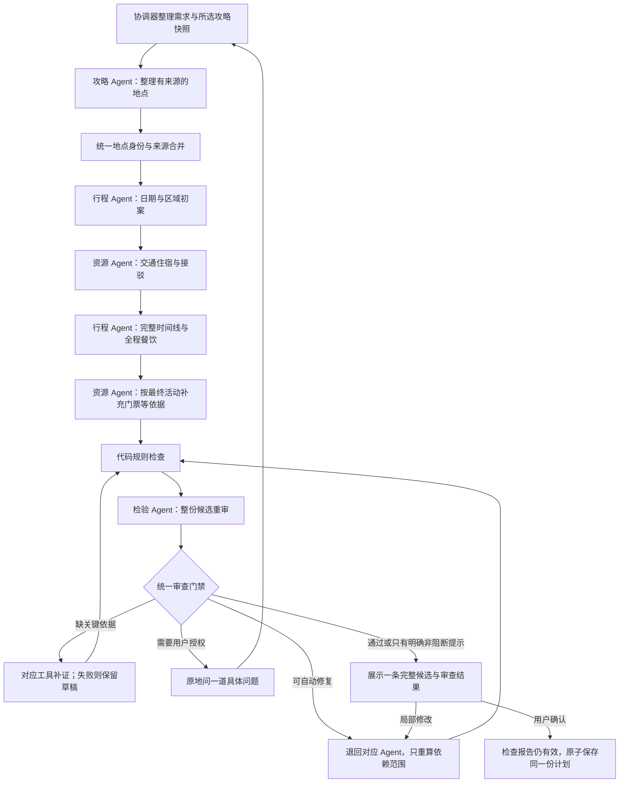

# 旅行规划多 Agent 重设计方案

日期：2026-10-14。状态：已按四 Agent 方案接入源码，尚未运行验收。保留 LangGraph、模型接入、工具适配器和版本机制，新增资源与独立检验角色、统一地点身份、全程餐饮去重、候选审查及保存门禁。未运行测试、构建、服务、模型调用、外部查询或界面验证，验收由用户执行；现有前端生产包未重建。

用户本次明确指出的错误是：重复地点、餐饮推荐重复。因此，统一地点身份、全程去重和完整候选的独立重审是第一优先级。增加角色本身不能保证正确，必须同时落实结构化交接、代码约束和审查门禁。

按用户最新要求收敛职责：需求理解保留在现有协调流程；交通、住宿和门票合并为资源 Agent；路线、时段和餐饮合并为行程 Agent。攻略与独立检验各保留一个角色。

本方案补充并取代 `TRAVEL_PLANNING_IMPROVEMENT_PLAN.md` 中的双 Agent 职责设计；保留用户主动选择攻略、一次一条完整候选、必要时原地问一道问题、确认同一份行程和由用户验收等约定。旧文档中的代码行号与部分状态说明已过时。

**改造前与问题直接相关的事实（行号为改造前定位）**

| 当前实现 | 依据 | 改造要求 |
| --- | --- | --- |
| Planner 只实例化 GuideAgent、RouteAgent | `backend/app/planner.py:90-98` | 明确拆分专责角色，协调器负责调度与提交 |
| RouteAgent 同时做整趟路线、每日安排、局部修改和冲突追问 | `agents/route.py`、`planner.py:1114`、`:1248`、`:1691`、`:314` | 剥离资源决策与独立检验，保留路线和日程统一负责 |
| 现有 review 只把已有冲突转成问题，PlanningReview 只有 question | `planner.py:309-314`、`models.py:237-238` | 完整候选均重审，即使规则没有报错 |
| 餐饮 used 集合在午餐、晚餐各自循环中重置 | `backend/app/dining.py:19-60`，尤其 `:23-24` | 午晚餐共用全程门店登记 |
| 餐饮按天调用，缺少跨日推荐占用记录 | `backend/app/planner.py:2072` | 在日程完成后统一生成全程餐饮推荐 |
| 景点已有 stop_id、部分 POI 去重和 source_references | `rules.py:72-118`、`planner.py:1563-1597`、`decisions.py:66-104` | 复用已有校验，统一实际地点身份并覆盖别名、跨日与局部修改 |
| 候选主线 assess 直接调用资源、活动与 check，没有进入图上的 after_check/repair | `backend/app/planner.py:1164-1165` | 将返工和重审接入真实候选主线，不能只给另一条图分支新增节点 |
| chosen_hotel 只把 selected_by_user 酒店作为日程锚点 | `backend/app/resource_planning.py:5-12` | 保留用户明确选择边界，未选酒店只推荐，不参与日程计算 |
| 事实刷新存在直接更新行程并结束的分支 | `backend/app/planner.py:282-288` | 所有影响计划或证据的写入口经过同一审查门禁 |

以上只能说明静态风险和改造位置，不能据此认定所有实际重复都由同一原因造成。

**四个 Agent 与职责边界**

| Agent | 唯一主要职责 | 输入 | 结构化交接 | 允许请求的工具 |
| --- | --- | --- | --- | --- |
| GuideAgent：攻略 | 提取与整理所选攻略证据 | 用户勾选的正文、图片、需求中的城市 | 景点与餐饮来源池、别名证据、来源冲突、明确必去/排除 | 现有文字/图片模型能力；不自动采集新攻略 |
| ResourceAgent：资源 | 查询、比较与推荐交通、住宿和门票资源 | 日期、出发地址、交通/房间条件、活动区域、预算及真实查询结果 | 班次与到离、站点接驳、住宿推荐、用户已采用酒店与入住段、票种状态、费用口径与缺口 | 飞猪交通/住宿/门票、高德站点/酒店/接驳；不安排游览活动 |
| RouteAgent：行程 | 将有来源的地点与资源安排为完整可行行程 | 统一景点/餐饮池、交通与酒店锚点、用户约束、开放/预约说法、天气 | 分日与顺序、游览时长依据、时间线、全程餐饮推荐、调整理由与资源反馈 | 高德地点/门店、允许方式的路线、日期匹配天气、攻略替代反馈；不自行编造或替换报价 |
| ReviewerAgent：检验 | 独立重审整份候选，提出有依据的问题 | 需求与授权、完整计划、原始来源、查询记录、规则结果、地点出现清单 | 审查结论、发现、补证请求、返工归属 | 只读取已保存证据；新查询由协调器转给专责 Agent |

协调器沿用 Planner 与 LangGraph，是代码调度器，不计入四个 Agent。需求理解、修改范围解析和用户追问继续复用现有协调节点与模型调用，不增加独立需求 Agent。金额汇总、日期覆盖、ID 合法性、全程去重、版本比较和权限校验仍由代码执行。四个角色可以复用当前配置模型；独立的是任务、上下文、输出结构和权限，无需新增四套模型设置。

GuideAgent 只交接资料，ResourceAgent 只提交资源选择与事实，RouteAgent 统一负责地点分日、顺序、日程和餐饮。行程内可以分阶段、分日期调用同一 Agent，不为每一小步增加角色。餐饮默认是可选推荐，不强塞进活动或当作必去景点。ReviewerAgent 不修改需求、不替行程 Agent 写新路线、不允许直接保存文档。

RouteAgent 提出停留时长及其依据，具体起止、缓冲相加和时间窗判断由代码计算。排不下时，在用户允许范围内调整普通可选景点；若需换交通或用户已采用的住宿，则提交带日期和原因的资源反馈，由协调器交给 ResourceAgent。资源 Agent 不能为了适配资源静默删点或改旅行日期。酒店必须由用户明确采用才参与行程；未选择时不暂用、不计算酒店起终点、放行李、接驳和住宿费用，不要求先选酒店，也不因此阻止候选确认。`selected_by_user` 不能自动设置为 true。

**统一地点身份与去重**

保留原 `stop_id`、来源和证据，新增 `canonical_place_id`、`entity_kind`、`alias_names`、`source_refs`、`match_status`、`parent_place_id`。原始来源 ID 与统一地点 ID 建立映射，必去、排除、锁定和历史显示都保留对应关系，不因合并资料丢失用户约束。

身份匹配优先采用已确认的城市与高德 POI ID。同一真实地点的简称、旧名或重复 POI 记录，应结合地址、坐标和已有查询/原文证据确认等价；距离相近或名字相似只能生成待核实关系，不能直接合并。坐标相同也可能是同一建筑内不同店铺。

同名不同城市、同品牌不同门店、同一景区不同有独立证据的子活动应保持区别。酒店、车站等接驳锚点多次出现不属于重复游览；景区与子景点的包含关系应交叉检查时间是否重复计入，不能一律按名称合并或删除。

全程维护出现清单：

```text
canonical_place_id / activity_identity
role: visit | meal_option | meal_selected | anchor
date / meal / activity_id
source_refs / address / poi_id
repeat_exception
```

默认规则如下：

1. 同一实际游览活动在全程只安排一次，不能用不同攻略 ID 在另一天再次出现。多篇攻略只增加来源，不增加活动副本。
2. 同一餐厅门店在全程推荐列表默认只出现一次，午餐、晚餐和不同日期共同分配；每餐最多保留两项，少于两项可以直接少推荐。
3. 已明确采用或保留的餐厅先占用身份，其余推荐不能再次推荐这家门店。不同分店可分别保留，但明确显示分店与地址。
4. 用户明确要求再次游览或重复用餐时，记录有作用范围和回答来源的 `repeat_exception`。例外不能豁免时间、来源、预算等其他约束。
5. 尚无法确认是否同一地点时，请求消歧。必要游览地点缺少位置依据时保留待核实草稿；无法消歧的普通餐饮推荐可以省略并说明，不用重复条目补足数量。

餐饮由 RouteAgent 在每日时间线稳定后，配合共享餐饮模块一次读取整趟行程生成。根据各餐次附近的活动分配门店，代码统一检验所有推荐身份，不设独立餐饮 Agent。局部修改时保留范围外已有推荐及其占用记录，只重分配受影响的餐次；如需调整范围外推荐，先说明影响，不静默迁移。

重新生成采用替换受影响列表的方式，不能在旧列表后累加。生成过程、代码校验和最终重审分别扫描同一全程出现清单，不能仅提示模型“不要重复”。

现有 `update_day_places()` 本身已经整体替换当天推荐，静态阅读没有发现推荐列表追加累积。本方案重点修复跨餐次/跨天登记的缺口，并要求未来拆分后保持替换语义。

**依赖与运行流程**



初案只用于确定城市日期、活动区域和查询条件，不提前承诺游览时段。ResourceAgent 先查询交通以确定每日可用时间，按活动区域提供住宿推荐；只有用户已选定酒店才提供住宿起终点。RouteAgent 负责地理顺序、时间线和餐饮。最终活动确定后，ResourceAgent 补查对应门票等资料。已采用的新锚点造成不合理安排时，只反馈受影响城市/日期；如需改变住宿晚数或跨城日期，必须确认是否在用户授权内，并重新核实相关交通与住宿。

独立攻略解析和已固定日期的独立资源查询可以并行。住宿选择依赖已知交通与区域，完整行程依赖资源，重审依赖完整计划，这些步骤不能同时对共享草稿自由写入。行程与资源之间的反馈只通过协调器，受共享返工预算限制。现有高德调用限制和会话复用继续生效。

不需要住宿的一日游跳过住宿查询；完整表单且没有新消息时需求直接由代码校验；无攻略餐饮来源时返回空推荐。四个职责不意味着每次请求必须机械执行所有角色，局部调整只调用受影响角色，但完整候选仍必须重审。

**完整候选的独立重审**

Reviewer 使用全新审查上下文。它应先对照用户需求和原始证据，再查看各 Agent 的理由，不能只读规划总结或现有 `issues`。

输入包含：全部日期的最终时间线、活动与餐饮出现清单、交通班次与接驳、酒店与入住日期、票价/预算代码计算、所选来源证据、查询结果及查询时间、必去/排除/锁定项、当前有效的用户回答和重复例外。

必须逐项检查并记录 `ok / warning / blocker / unknown / not_applicable`：

| 检查项 | 重点 | 默认归属 |
| --- | --- | --- |
| 地点重复 | 同 POI、别名、不同攻略 ID、跨日重复、景区包含关系 | 攻略身份合并、行程 Agent |
| 餐饮重复 | 同一门店在同餐、午晚、跨日、已采用与备选间重复 | 行程 Agent 与共享餐饮代码 |
| 来源 | 每个游览与餐饮点有授权来源，不把补充商品混入攻略来源 | 攻略 Agent |
| 用户约束 | 日期、城市顺序、必去、排除、锁定和最新授权一致 | 协调器与相应专责 Agent |
| 时间衔接 | 接驳、进站/登机缓冲、游览、预约、返程相互可衔接 | 资源与行程 Agent |
| 住宿 | 仅检查用户已采用酒店的夜晚覆盖、地址、入住/退房、通勤；未选酒店时 not_applicable | 资源 Agent |
| 金额口径 | 已知、估算、未知分开，房晚/人数/儿童/票种不误用，不重复计费 | 代码计算、资源 Agent 补证 |
| 事实质量 | 位置和关键路线有依据；天气匹配日期；开放时段和报价没有冒充保证 | 对应事实责任 Agent |
| 整体合理性 | 地理折返、游览强度、同一天或跨日互相矛盾的说明 | 行程 Agent |
| 修改范围 | 范围外与锁定项目得到保留，所有变化有差异说明 | 协调器与责任 Agent |

发现必须包含 `code`、严重度、相关日期/餐次、字段路径、地点/活动 ID、依据引用、说明、责任 Agent、建议修复范围。无法引用现有来源或查询记录的事实断言不能直接成为审查结论；模型提出的疑点只能标为待核实。代码检查覆盖完整计划，不让“未检查”被当成通过。

审查报告状态：

| 状态 | 行为 |
| --- | --- |
| `pass` | 全部必查项完成，无阻断与未解决用户决策，可以展示候选 |
| `pass_with_warnings` | 只有允许保留的非阻断缺口，候选同时显示这些提示 |
| `revise` | 确定的规划错误，退回指定 Agent 修正；不能确认 |
| `needs_evidence` | 缺少影响可行性的依据，协调器安排补查；不能确认 |
| `needs_decision` | 解决问题必须改变用户约束，协调器通过现有决策流程组织一道问题；不能确认 |

模型超时、格式错误、审查步骤未完成另记运行失败或 `review_unavailable`，不得转换成 `pass`。最终状态由代码结合规则、报告和证据有效性判定；LLM 不能覆盖数值冲突、重复约束或版本门禁。

远期天气未覆盖、缺普通景点最新营业说明、门票某票种价格未知，可以明确保留提示，不能据此声称全部事实已核实或总预算确定满足。已知闭馆且安排入馆、关键地点/交通缺失、确定重复、未授权改变必去项、必要交通不可用或已采用酒店存在硬冲突属于阻断。酒店未选不阻断、不强制追问，住宿不计入当前费用合计。允许保存的非阻断提示必须在候选中可见。

**审查报告绑定与提交门禁**

报告至少保存：`review_id`、`schema_version`、`run_id`、`draft_revision`、`plan_hash`、`review_basis_hash`、所用模型/指令版本、检查覆盖、发现、结论、审查时间及证据有效期。

`plan_hash` 覆盖待确认计划内容，排除报告本身；`review_basis_hash` 覆盖需求、来源内容与地点映射、锁定、最新用户决策、重复例外、查询结果版本/时间、规则版本。重新查询即使活动顺序不变，也应使旧报告失效。报价时效到期不继续展示为当前已核验报价。

首次候选、局部修改、资源切换、酒店区域重查、补图依据、报价/天气刷新、体验采用、重新回答问题都必须经过同一审查出口。事实刷新不能用“结构没变”绕过重审；没有改变确认内容的刷新可以更新证据与报告，但不能改写已保存历史版本。

提交时检查当前 `base_version`、`updated_at`、`draft_revision`、两个哈希和审查结论。确认只保存已展示的同一快照，不再调用规划 Agent。任何条件变化则保留原内容，提示新的候选或重新审查。

旧候选无审查报告时显示“待重新审查”，不能因旧 `confirmation_blockers` 为空而直接确认。旧已保存历史仍可查看，明确说明没有新版审查，不修改历史事实。

必须覆盖这些现有旁路：`review_result` 的直接结束分支、局部修改失败回原候选、返回路线步骤恢复旧预览、`save` 的幂等分支、手动保存 API。重审失败不能覆盖最后一份有效候选或已确认行程。

**返工与用户追问**

所有问题分为代码可纠正、专责 Agent 可调整、工具需补证、用户需授权四类。Reviewer 标明责任和范围，协调器决定实际执行：资料问题交攻略，资源问题交资源，日程或餐饮问题交行程，授权问题进入现有决策节点。

| 变更 | 重新计算 |
| --- | --- |
| 合并重复攻略地点 | 受影响地点映射、日期分配、路线、日程、餐饮、预算及全程重审 |
| 改交通班次 | 受影响日期可用时段、接驳、必要住宿、路线、日程、餐饮、预算及全程重审 |
| 用户采用或更换已采用酒店 | 受影响入住段的接驳、路线、日程、餐饮、预算及全程重审 |
| 改某天活动 | 该天路线/时间/门票/餐饮；检查跨日地点占用与预算，再全程重审 |
| 改餐饮推荐 | 受影响餐次，扫描全程门店占用并重审；不重新查交通酒店 |
| 更新报价 | 更新对应费用与证据；必要时调整资源，再重审 |

每份候选自动返工最多两轮；所有自动修复和补证纳入同一预算，不能在不同节点各自重置形成循环。相同问题指纹、相同计划/依据没有进展时提前停止；外部认证、无库存等稳定失败不反复查询相同参数。

确定重复且有同池替代时直接修复，不让用户重复决定。无可用餐饮替代时减少推荐，说明来源不足。涉及必去/锁定项、旅行日期、预算或交通限制的取舍，保存草稿后问一道具体问题。问答历史去重，最新授权替代旧规则；已回答的接受超限不再次追问。

返工用尽后显示未完成草稿、具体失败原因和继续处理入口，不标为可确认的完整候选。Reviewer 的语义判断仍可能误判或漏判，不能宣传为事实保证。

**结构化交接与存储**

每个 Agent 返回自己的领域产物或有限补丁，不能返回整份旅行文档覆盖其他角色结果。共享交接头包含运行 ID、草稿版本、输入哈希、角色、模型/指令/输出 schema 版本、证据引用和影响范围。

协调器串行检查并合并，拒绝晚到或依据已变化的结果。缓存继续复用现有 `agent_results`，补入角色版本、模型身份和依赖证据版本；失败查询不缓存成成功事实。断点恢复不能把旧 Agent 输出或旧审查报告套到新草稿。

继续使用 `queries` 保存脱敏后的真实查询结果，`checkpoints.sqlite` 保存执行检查点，旅行文档保存完整候选、地点映射、全程占用记录和审查报告。审查摘要用结构化发现与简短解释，不存储或展示模型内部思维过程。

**前端变化**

候选仅在检验完成后作为可确认路线出现。处理期间显示实际阶段，如“生成全程餐饮推荐”“检验 Agent 正在重审”“正在修复重复地点”。

候选卡显示审查结论、完成时间、发现与修正摘要、仍待核对的事实。发现指向对应日期/地点/餐次。重复餐厅合并来源后只显示一张推荐，分店明确标名；不同攻略共同推荐的地点显示多条来源。

确定重复、关键依据缺失、未审完或报告过期时禁用确认；后端同样检查。局部修改后显示新旧差异和新的审查结果。SSE 继续使用现有机制，不引入第二套任务系统。

**本次源码改造与验收范围**

1. 先统一地点身份、全程出现清单和代码去重。重构 `dining.py` 及 `update_day_places()` 的按天推荐入口，复用原有来源引用，不先堆叠更多提示词。
2. 增加 ReviewerAgent、ReviewReport 和统一审查门禁，覆盖候选展示、所有修改入口与保存旁路。即使其他职责尚未拆完，也先保证每份完整候选都得到独立重审。
3. 将现有交通、住宿和门票节点接入 ResourceAgent，保留工具适配器；RouteAgent 统一负责路线、每日时间线和全程餐饮。需求解析继续留在现有协调流程，补两者交接与依赖重算。
4. 接前端审查摘要、失效状态、返工进度与差异展示；更新 README 中旧角色数、主线和验收说明。

主要文件：

- `backend/app/agents/`：复用 `runtime.py`；仅新增 `resource.py`、`reviewer.py`，调整现有 `guide.py`、`route.py` 与导出。
- `backend/app/planner.py`：节点调度、统一审查出口、领域合并、返工预算与依赖失效。
- `backend/app/models.py`：领域产物、统一地点/出现清单、审查报告及严格状态约束。
- `backend/app/rules.py`、`decisions.py`、`dining.py`：复用数值检查；增加全程去重与审查确认门禁。
- `backend/app/store.py`：保存产物/报告与缓存版本；`main.py` 保存和变更入口共用门禁。
- `frontend/src/types.ts`、`App.vue`、`PlanView.vue`、`workflow.ts`：展示审查、明确分店、进度与确认条件。

不新增编排框架、后台服务或付费数据源。后续实现时可以编写针对真实缺陷的测试，但本项目规则禁止由助手运行测试、构建、验证脚本和 computer use。

本次新增用户运行的回归用例 `backend/tests/test_four_agent_review.py`，并调整资源选择、门票、用户选择住宿边界与行程保存的相关用例。未执行这些用例。前端审查面板是 `frontend/src/ReviewPanel.vue`；由用户先停止服务、执行 `build.bat` 与 `start.bat`，再强制刷新后验收新版。

**用户验收场景**

| 输入/操作 | 应看到的结果 |
| --- | --- |
| 两篇攻略用不同 ID/简称推荐同一地点 | 全程只游览一次，两个来源都保留 |
| 同一地点不同 POI 记录或景区与子活动 | 先核实等价/包含关系，不只凭名字或坐标误合并 |
| 一个餐厅靠近午餐和晚餐活动 | 默认只在一个餐次推荐，不重复展示 |
| 连续两天活动靠近同一家门店 | 全程默认仅推荐一次；另一天用其他来源或减少推荐 |
| 同品牌不同地址分店 | 不误合并，分店信息清楚 |
| 候选来源只有一家餐厅 | 不重复凑成多个餐次推荐，不自动引入未选择来源 |
| 修改第二天活动或换酒店 | 重算受影响部分，不叠加旧餐饮；检查其他天占用并再次全程审查 |
| 用户明确要求重复去某地点或餐厅 | 记录范围与授权例外，仍检查时间和费用 |
| 改需求、重新回答、更新报价 | 旧审查失效，新报告匹配新计划与依据 |
| Reviewer 超时或返回错误格式 | 保留草稿和原因，不能显示已通过 |
| 旧候选、返回上一步、断点恢复、手动保存 | 所有确认入口均要求当前有效审查 |
| 已审候选点击确认 | 保存同一快照，不生成另一份日程 |

实现验收应看上述行为与证据，不以“四个 Agent 已创建”或“模型说通过”代替正确性结论。
