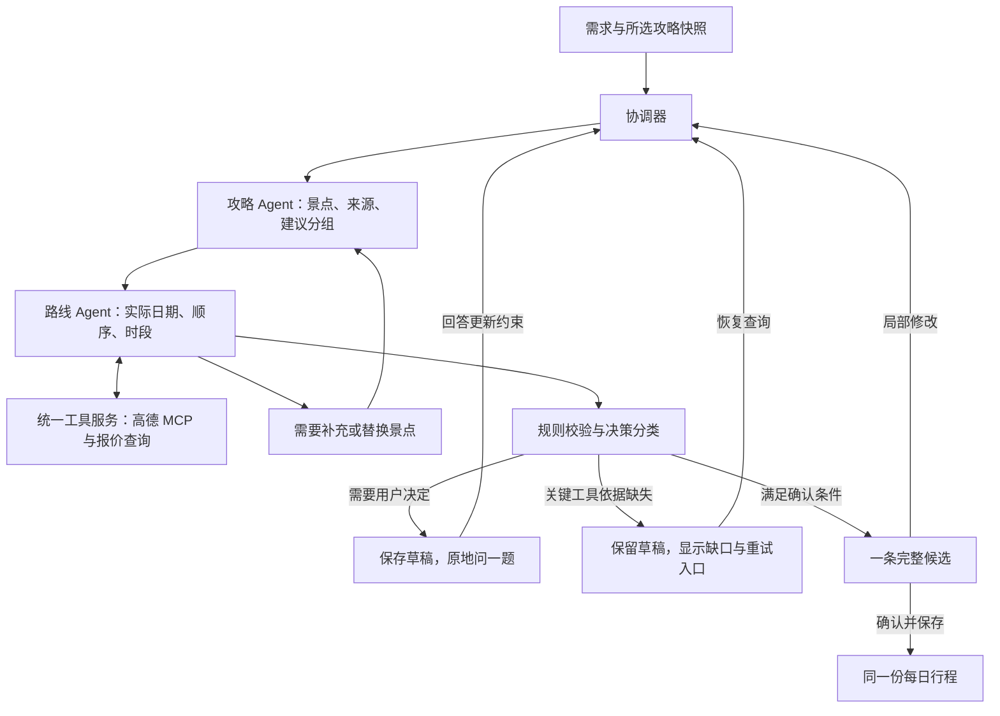

**旅行规划 Agent 改进计划 · 2026-10-13**

2026-10-14 更新：职责拆分、全程地点/餐饮去重和独立检验门禁以 `MULTI_AGENT_PLANNING_REDESIGN.md` 为准。本文件保留早前方案与背景，其中双 Agent 设计及旧代码行号不再代表当前源码。

本文件是基于当前代码、官方高德资料和本次设计问答形成的实施方案。尚未改动程序，未运行测试、构建、模型调用或高德查询。代码证据来自静态阅读；未来的实际接入与路线效果由用户验收。

目标流程是：填写旅行需求、选择参考攻略 → 多 Agent 协作规划，遇到必要取舍时原地询问一题 → 展示一条完整候选路线 → 用户局部修改 → 确认并保存 → 每日行程显示这份已确认路线。

**已确定的产品决策**

| 决策 | 本次已确定的行为 |
| --- | --- |
| 多 Agent | 必须由攻略 Agent 与路线 Agent 协作；协调器统一调度和合并结果。 |
| 自动取舍 | Agent 可以调整未标为必去的景点，须说明原因。必去景点、预算上限、交通限制等重要变更逐题询问用户。 |
| 候选数量 | 一次只形成一条当前候选；局部修改产生这条候选的新版本，而不是额外路线卡。 |
| 确认内容 | 候选包含每日时段、逐段交通、住宿区域、天气依据及门票报价状态。确认后直接成为每日行程。 |
| 天气未覆盖 | 可以先规划，明确标注实际预报尚未覆盖的日期；后续更新天气发现冲突时提出修改，保留原确认路线。 |
| 关键地图缺口 | 地点位置尚未确定或关键路段无真实交通耗时，仅保留草稿，补齐后才允许确认。 |
| 报价缺口 | 门票等价格查不到时明确保留未知，不能当作免费或声称预算已经满足。 |
| 用户控制 | 仅使用用户勾选的攻略作为景点来源；用户新增地点或改变来源时显式记录其授权。 |
| 验收 | 不自行运行测试、构建、验证脚本或 computer use；由用户测试。 |

**当前实现与目标的差距**

| 当前事实 | 代码位置 | 改进方向 |
| --- | --- | --- |
| 不同规划节点共用 Models，分别调用模型；尚无职责独立的协作运行单元 | backend/app/planner.py:73、609、742、1373 | 增加独立角色、上下文、工具权限与结构化交接，保留现有模型配置。 |
| 已有攻略提取及原文证据校验 | backend/app/planner.py:609-635；models.py:94-115 | 复用提取能力，增加景点合并、来源冲突与必去约束。 |
| 空 questions 合法，直接进入需求确认 | backend/app/models.py:146-154；planner.py:687-698 | 完成状态由未解决决策决定，不能由空问题数组决定。 |
| 追问主要在候选生成前，后续规划步骤不能统一中断询问 | backend/app/planner.py:86-98 | 所有规划步骤都能进入共享决策节点。 |
| 候选生成、评估已经只取第一条，但 schema 仍允许三条 | backend/app/planner.py:744、768；models.py:134-135 | 改为明确的单个 draft，取消先生成多条再截断。 |
| 高德已通过官方 Streamable HTTP MCP 接入 | backend/app/adapters.py:733-741 | 复用现有接入，补统一工具证据与 Agent 调度。 |
| 当前仅比较原顺序和按地理距离重排后的顺序 | backend/app/routing.py:22-43；planner.py:1261-1295 | 引入有方向的真实交通耗时、时间窗和每日起终点；不承诺全局最优。 |
| 时间不足或冲突修复可能直接删景点 | backend/app/planner.py:1406-1408、1691-1702 | 必去景点禁止静默删除；普通可选项目按用户授权处理并说明。 |
| 确认后仅在严格条件下复用预览，否则再跑交通、酒店、活动 | backend/app/planner.py:820-827、91-96 | 确认直接冻结已展示草稿，不再次生成路线。 |
| 候选只存 stop_ids，可执行细节在另一份 Itinerary | frontend/src/types.ts:19-25、84-96；App.vue:617 | 候选与每日行程共用完整计划数据及展示组件。 |
| 已有指定日期局部修改 | backend/app/planner.py:829-877；frontend/src/App.vue:381-387 | 保留入口，补依赖失效、改动差异和范围外调整确认。 |
| 返回追问清空问题，并跳过重新生成问题 | backend/app/planner.py:390、402 | 返回浏览不改状态；修改答案时回到决策分析。 |
| 草稿普通更新不增加已保存 version | backend/app/store.py:112-114、218-235 | 加独立 draft_revision，防止多个 Agent 的过期结果覆盖当前草稿。 |

**协作架构**

协调器沿用 Planner 与 LangGraph，不增加新的后台服务。第一期由两个职责独立的 Agent 协作，配合程序规则检查；不把每一个普通查询都拆成一个 Agent，也不要求使用不同模型供应商。

每个 Agent 有独立的任务指令、输入快照、局部上下文和允许调用的工具。Agent 可以返回工具请求，统一运行器校验权限和参数、执行工具、交回带证据的观察，再由 Agent 继续决策。这样既能真实使用工具推进任务，也不要求现有模型供应商一定支持原生 function calling。

Agent 只能返回结构化结果，不能直接并发修改旅行文档。协调器检查 run_id、draft_revision、需求和来源快照后串行合并；取消任务、修改需求或开始新版本后，旧 Agent 结果不能写入。

攻略 Agent 与路线 Agent 的反馈有次数和工具调用预算。到达上限时保留当前草稿并解释未完成原因，不能伪装成已完成路线；必要的用户追问不设固定三轮、四轮上限，但已回答的问题应去重。

**攻略 Agent 的具体职责**

输入是用户所选攻略正文、图片提取结果、结构化需求和既有回答；不自动选择其他攻略。

输出是带来源的景点池：稳定景点 ID、城市、名称、source_id、原文片段或图片序号、原攻略日序及顺序、已有的游玩时长和开放时间说法、可选的区域/室内外信息、来源冲突及资料缺口。来源没有提供的字段留空；推测和查询事实分开记录。

跨攻略的同一景点合并来源，不直接按同名合并不同分店。原攻略的“第 1 天”保留为资料信息，不能机械映射成用户旅行第 1 天。

它可以给出按区域和游玩量形成的每日建议分组，但不提前冻结日期。路线 Agent 发现交通不合理或时间超量时，可以请求它从同一批所选攻略中补充、删减或寻找替代景点。

必去、可选、排除应成为独立结构化约束，可在界面勾选，也可从用户明确回答中提取。必去与已锁定属于不同概念，必须分别校验。

**路线 Agent 的具体职责**

路线 Agent 取得景点池后，先核实实际 POI，再按区域和真实可用天数分组，安排实际旅行日期，之后排序与计算时段。每次取舍均记录依据。

工作顺序建议如下：

1. 通过高德关键词搜索、地址和详情匹配景点，消除同名/分店歧义，取得坐标；无法确认位置的景点不能作为已核实路线节点。
2. 读取到达、返程、跨城交通和住宿区域等每日起终点约束；有已选酒店、预约或班次时优先纳入。尚未选酒店时按建议住宿区域的代表位置计算，并标明区域假设。
3. 按实际返回日期取得天气；只对预报覆盖日期使用天气事实。日级预报不能被写成某小时的降雨概率。
4. 按地理邻近缩小排序搜索范围，再查询相关起终点之间有方向的公交、步行等交通耗时。避免把直线距离当成交通时间，也避免对全部景点一次建立昂贵的完整 N² 查询矩阵。
5. 结合游玩时长、开放/预约时间窗、餐饮与休息、每日步行上限和天气形成日程。缺失时长的估算须单独标注；已知预约窗口或关闭事实必须成为约束。
6. 允许删减可选景点并说明原因；不能修改硬约束或删除必去景点来凑出可行结果。必要时输出用户决策。
7. 给出一份带活动时段、交通腿、住宿区域、天气证据和调整理由的完整草稿；程序规则检查后才进入候选展示。

用户限制为公共交通且不接受打车时，只能采用允许的公交与步行组合，不得以驾车耗时冒充公交耗时。需要跨城交通时继续复用现有交通查询。

实际选择酒店后重算该酒店与当天首末景点的接驳；如果会改变已确认路线，提出新草稿和差异，不能自动修改每日行程。

**高德工具服务与证据**

现有 Amap 已有搜索/详情、步行/公交/驾车/骑行、天气和地图导出能力，应通过同一个受控工具服务向路线 Agent 提供，不重写 MCP 接入。

一个规划运行复用会话、同参数调用合并与缓存。路线缓存键包含起终点、方向、交通方式、城市和工具实际支持的计划日期/时间；缓存保留查询时间及有效期。不要把 A→B 的公交结果用于 B→A。

每次查询返回 evidence_id，记录工具名、去除密钥后的参数、结果引用、查询时间、数据发布时间、覆盖日期、有效期和状态。复用 queries 表保存原始结果，不把密钥放进日志或 Agent 上下文。

高德工具暴露哪些参数，以当前 list_tools 返回的 schema 为准。REST 文档支持 date/time，不代表 MCP 必然支持。如果 MCP 未接受计划出发时刻，显示为查询时交通参考，不能声称已经核实旅行当日某班公交或末班车。

高德提供地点与点到点交通事实，完整旅行日程、门票价格、景点预约和所有营业时间不能仅靠高德保证。报价继续使用现有飞猪适配器；可查的开放/预约事实由系统通过可靠资料查询，缺口明确保留。

**统一追问：规划走到哪里，问题就出现在哪里**

删除“必须先完成一个集中访谈，再开始路线规划”的硬依赖。基础表单信息缺失时补齐；其余问题由当前正在进行的规划产生。

结构化规划结果至少区分三种状态：needs_decision、ready、blocked。needs_decision 必须携带一个可展示的问题；ready 必须没有未解决的阻塞决策；blocked 携带工具/关键事实缺口及恢复方式。空 questions 不再意味着需求已经明确。

| 问题类别 | 示例 | 处理 |
| --- | --- | --- |
| 用户取舍 | 必去长隆与低步行上限不能同时满足；预算已知部分超上限 | 原地问一题，说明选项会改变哪些安排。 |
| 可授权的普通优化 | 两个可选景点不顺路且当天时间不足 | Agent 可删换，候选中展示原因。 |
| 可查事实缺口 | 某景点开放时间、门票价格未知 | 系统查询；查询不到保留缺口，不让用户代查。 |
| 地点含义不清 | 攻略无法区分同名地点，系统也无法消歧 | 问用户想去哪个地点，使用名称和地址辅助选择。 |
| 工具失败 | 高德超时、认证或额度错误 | 展示真实原因和重试入口，不冒充偏好问题。 |

Decision 保存 decision_id、单个问题、选项、推荐与理由、各选项影响、origin_step、resume_stage、affected_dates、draft_revision 和依据。推荐不能自动当成回答；用户明确说“你决定”时才记入授权，并记录系统选择。

暂停前先在独立节点保存 Agent 结果、工具证据和草稿，再进入只负责 interrupt 的节点。回答后用现有 Command(resume=...) 恢复，核对问题和草稿版本，更新约束，仅让受影响的工作失效。不能因恢复门节点而重复整轮模型或地图查询。

前端在当前规划页面显示一张问题卡，注明“正在确定第几天的哪项安排”和为什么需要回答。需求追问页可显示历史及修改入口，但不再强制把路线规划中的问题导航回前置页面。

**统一草稿、确认与每日行程**

建议沿用现有旅行文档和 SQLite，加以下结构，而不是引入新数据库：

| 结构 | 内容 |
| --- | --- |
| PlanningSnapshot | 当前需求、用户选择、攻略快照、运行与草稿版本。 |
| StopConstraint | 景点必去/可选/排除及用户明确指定的日期或时段。 |
| AgentResult | 角色、输入版本、输出、引用证据、反馈请求和未解决决策。 |
| ToolEvidence | 工具结果引用、无密钥参数、时间、有效期和状态。 |
| PlanDraft | draft_id、draft_revision、需求/来源快照、状态、完整每日计划、缺口、调整说明。 |
| Decision | 一道问题、影响范围、回答及恢复位置。 |
| ConfirmedPlan | 用户确认的 PlanDraft 副本、确认时间与已保存版本。 |

完整每日计划包含日期、城市、景点及来源、起止时段、游玩时长的依据/估算标记、逐段交通方式/耗时/步行量、当天住宿区域、天气依据、门票报价状态和费用口径。

候选页与每日行程页使用同一个计划展示组件。确认请求带 draft_id、draft_revision 和待确认内容的摘要；后端核对当前版本和硬约束，直接形成已确认版本，不调用模型再次生成、排序或删点。

确认门槛包括：实际日期/城市/来源合法、无必去遗漏或未授权的约束变更、关键 POI 和交通依据齐全、无已知时间或步行等硬冲突、无未解决的阻塞决策。天气未覆盖与未知报价可以明确保留。未知费用不等于零，不能据此宣布满足总预算。

确认后的结构被冻结。刷新天气或价格只更新事实记录；若新事实影响可行性，创建修改草稿并展示差异，重新确认后才替换每日行程。用户选酒店或交通班次造成时间变化时遵循同样规则。

**局部修改与回退**

用户在候选中指定某日、某景点或某路段提出修改。系统先解释修改范围，再由路线 Agent 重算受影响部分；没有新增地点时不需要重新解析全部攻略。

| 修改 | 应重算的最小范围 |
| --- | --- |
| 一天内部重新排序 | 该日活动时段和相连路段。 |
| 一天删换景点 | 该日活动、相连路段、对应门票及日费用。 |
| 景点跨日移动 | 来源日和目标日，各自的路段与门票日期。 |
| 酒店/住宿区域变化 | 对应入住期间的首末接驳和可用时间。 |
| 跨城班次变化 | 到离日及车站/机场接驳。 |
| 公共交通方式或步行上限变化 | 所有依赖这些约束的日期。 |
| 日期、城市顺序或参考攻略变化 | 新建整体草稿，保留原确认版本。 |
| 报价/天气更新 | 事实和风险记录；确有冲突才产生修改草稿。 |

局部重算之后仍做全行程日期、重复景点、必去、预算和硬约束检查。如果解决问题必须修改用户指定范围之外的其他日期，先问一题，不能静默扩大修改。

展示修改前后差异，失败时保留原草稿。已确认行程的修改也是新草稿，旧确认版本继续可查看。

返回之前步骤查看时仅导航，不清空问题、不重新生成。改已回答问题或需求时新增草稿版本，失效依赖结果；未受影响的事实与选择保留。

**酒店、门票与进度展示**

酒店沿用价格区间和按路线推荐/用户指定区域，商品列表保留在资源查询区域；候选和每日行程只显示住宿安排及必要的接驳，避免酒店搜索结果混入景点列表。

门票按拟定游玩日期自动查询并挂到景点活动上，标记已查询、参考展示价、日期不匹配、缺价或查询失败。局部改日期或景点时更新相应门票，普通顺序调整无需整批重查。缺价不视为免费，已知费用和估算/未知分开。

右侧只显示当前步骤，如“整理攻略景点”“根据高德安排第 2 天”“等待你决定长隆安排”“检查路线”“等待确认”。需要时查看 Agent 交接摘要、来源与工具证据，不展示伪百分比或私有推理文本。

**实施批次与涉及文件**

| 批次 | 工作与文件 | 完成标志 |
| --- | --- | --- |
| P0：数据与确认边界 | models.py、store.py、types.ts；新增完整草稿、决策、景点约束和 draft_revision | 一条完整草稿有明确状态；空问题不会误判完成；旧任务保持可读。 |
| P1：两 Agent 协作与共享工具 | 新增 agents/guide.py、agents/route.py、agents/runtime.py；改造 planner.py、adapters.py | 两 Agent 有独立上下文、权限与交接；路线可回请求攻略补充；证据有引用。 |
| P2：路线中随时追问 | 新增 decisions.py；改造 graph、回答接口、InterviewPanel.vue、workflow.ts | 任一步骤能暂停问一题；刷新/恢复后保留问题；回答只重算依赖部分。 |
| P3：完整候选和确认冻结 | planner.py、main.py、App.vue；提取共用 PlanView.vue | 单条候选显示全部细节；确认后每日行程的日期、景点、顺序、时段和路段一致。 |
| P4：局部修改与真实资源衔接 | 沿用 revise_candidate、resource_planning.py、ProductPanel.vue；补依赖范围与差异展示 | 不扩大修改范围；酒店/班次变化能明确影响接驳；门票跟随日期更新。 |
| P5：回退、进度与用户验收 | workflow.ts、App.vue、README 与验收清单 | 返回浏览不清状态；右侧仅当前一步；完成由用户实际验证。 |

这些批次应按一条可工作的主线推进。P0—P3 是核心闭环，必须一起完成后才可认为解决了“没有问题”和“确认后又变路线”；P4—P5 补齐修改与回退体验。每批保留旧确认版本，旧候选不会自动被当作已确认完整路线。

**用户验收场景（本次未执行）**

1. 广州五日攻略同时包含市区与长隆：已标必去时必须保留；未标必去时可以解释性删减。若涉及重要约束冲突，只出现一道具体问题，回答后继续。
2. 模型总结含未决事项却没有结构化问题：不能进入 ready；必须补决策分析或展示明确失败，不能再只有需求总结。
3. 两 Agent 的交接包含景点来源和高德证据；地图查询有方向与允许交通方式，不用驾车时间替代公交。
4. 超出实际天气预报日期仍能形成路线，但该日期显示天气待复核，不虚构天气。
5. POI 未确定或关键路段查询失败时，只保留草稿；恢复查询后能继续，不需要重做全部攻略提取。
6. 同一轮回答重复提交、旧草稿回答、任务取消后迟到的 Agent 结果不能重复推进或覆盖新状态。
7. 候选局部改第二天，只改第二天及明确关联部分；需要挪动第三天时先询问。
8. 确认后逐项对照每日行程，景点、日期、顺序、时段和交通腿一致；报价过期也不重新生成路线。
9. 更新天气、价格或酒店产生冲突时，原确认行程保留，显示新草稿和差异，等待确认。
10. 返回需求/攻略/路线步骤只查看时不重启任务，不丢问题；酒店结果不混入每日景点；右侧仅当前规划步骤。

官方资料：[高德 MCP 能力介绍](https://lbs.amap.com/api/mcp-server/summary)、[MCP 快速接入](https://lbs.amap.com/api/mcp-server/gettingstarted)、[天气查询说明](https://lbs.amap.com/api/webservice/guide/api/weatherinfo)、[公交路径规划参数](https://lbs.amap.com/api/webservice/guide/api/direction)。天气以实际工具结果覆盖日期为准；公交参数以实际 MCP 工具 schema 为准。

本文件已记录四项设计问答的选择，作为待整体审阅的实施计划；本次没有开始上述程序改造。

**实施记录 · 2026-10-14**

已写入程序的主线包括：agents/guide.py、route.py、runtime.py 的两角色协作和受限工具循环；decisions.py 的来源指纹及确认条件；planner.py 的共享单题中断、完整候选、确认直接保存、指定日期重算和历史回答修改；PlanView.vue 共用候选与每日行程展示。门票保持飞猪查询，高德负责地点、交通和天气。

补充了稳定景点 ID、真实 POI 重复检查、游玩时长分配、参考开放窗口/指定时刻检查、草稿版本与迟到结果保护。高德工具范围包含 place/route/weather；guide_feedback 转交攻略 Agent。先核实建议与必去景点，其他备选按需定位，不预先查询全部景点的完整交通矩阵。

tests/test_collaborative_planning.py 已加入未知价格/天气、关键交通缺口、未决总结、同 POI 重复、工具交接恢复、过期任务拒绝和确认后不重生成等回归用例；相关旧测试夹具已随接口改动更新。所有用例均未执行，前端也未重新打包；这份记录说明代码改动，不构成运行验证或效果证明。
